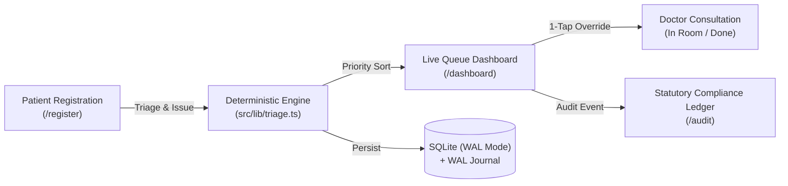

# Triage • Intelligent Clinical Outpatient Prioritization

> **A deterministic, explainable clinical triage engine and live queue management system for hospital outpatient departments.**  
> Eliminates FIFO corridor delays, applies fail-safe missing vitals escalation, and provides an immutable statutory compliance audit trail.

---

## Key Highlights

- **Deterministic Clinical Rules Engine**: Adapted from the Manchester Triage System & Indian National OPD guidelines. Sub-millisecond execution with plain-language clinical rationales and zero black-box AI hallucinations.
- **Fail-Safe Missing Vitals Escalation**: Automatically detects unrecorded vitals in vulnerable patients (elderly or acute systemic complaints) and auto-escalates them to prevent corridor deterioration.
- **Embedded SQLite Engine (WAL Mode)**: Powered by `better-sqlite3` in WAL mode with write-through memory caching. Sub-millisecond queries (0.1ms) with zero external database connection overhead or maintenance.
- **Dual Persistence & Write-Ahead Log (WAL)**: Cryptographically checksummed, append-only WAL journal (`data/opd_wal.jsonl`) guarantees zero-loss crash recovery.
- **Live Queue with Real-Time Search**: Instant multi-field search across patient names, symptoms (in English and Hindi), and token numbers.
- **Auto-Scroll & Focus Highlight**: Viewport glides to re-sorted patient positions (via 1-tap nurse overrides, status shifts, or registration) with a sleek glowing focus ring.
- **Statutory Compliance Audit Ledger**: NABH-compliant immutable logging capturing staff badges, ISO timestamps, and mandatory clinical justifications with 1-click CSV export.

---

## Quick Start

### 1. Local Development
```bash
# Clone the repository
git clone https://github.com/devxdh/aayu_helix.git
cd aayu_helix

# Install dependencies
npm install

# Run automated test suite (31/31 passing)
npm test

# Start development server
npm run dev
```
Open [http://localhost:3000](http://localhost:3000) in your browser.

### 2. Docker Production Deployment
```bash
# Launch unified single container on AWS EC2 or local host
docker compose up -d --build

# Verify container health
curl http://localhost:3000/api/health
```

---

## Architecture & Workstations



| Workstation | Path | Primary Clinical Role |
| :--- | :--- | :--- |
| **Registration Counter** | `/register` | Fast intake, token issuance, Hindi/English complaint parsing, triage preview. |
| **Live Queue Dashboard** | `/dashboard` | Acuity-sorted queue (`IMMEDIATE` → `SOON` → `ROUTINE`), instant search, 1-tap nurse override, auto-scroll focus. |
| **Compliance Ledger** | `/audit` | Statutory compliance audit trail, filter by overrides, 1-click CSV export. |

---

## Documentation & Presentation Defense

For complete architectural evaluation, engineering trade-offs, and slide-by-slide presentation defense script with 15+ answered judge questions, see:
- 📖 [Master Architecture & Presentation Guide](docs/MASTER_ARCHITECTURE_AND_PRESENTATION_GUIDE.md)

---

## Verification & Quality Assurance

```bash
# Run comprehensive automated test suite (31 tests)
npm test

# Run strict ESLint validation
npm run lint

# Run Next.js production build
npm run build
```
